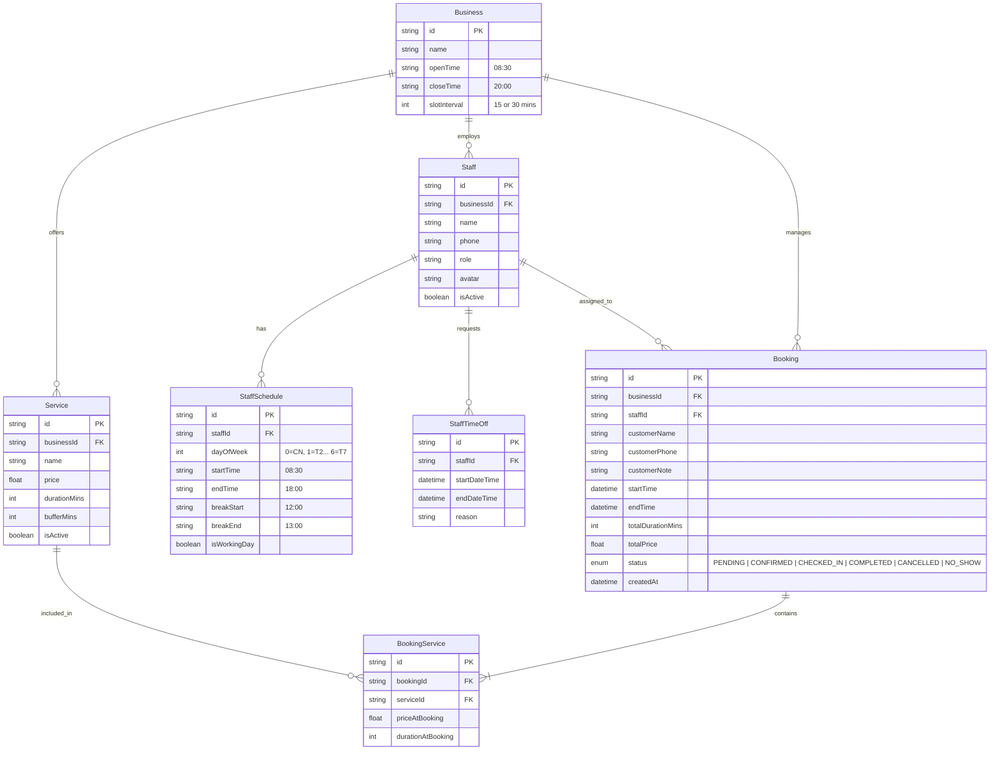
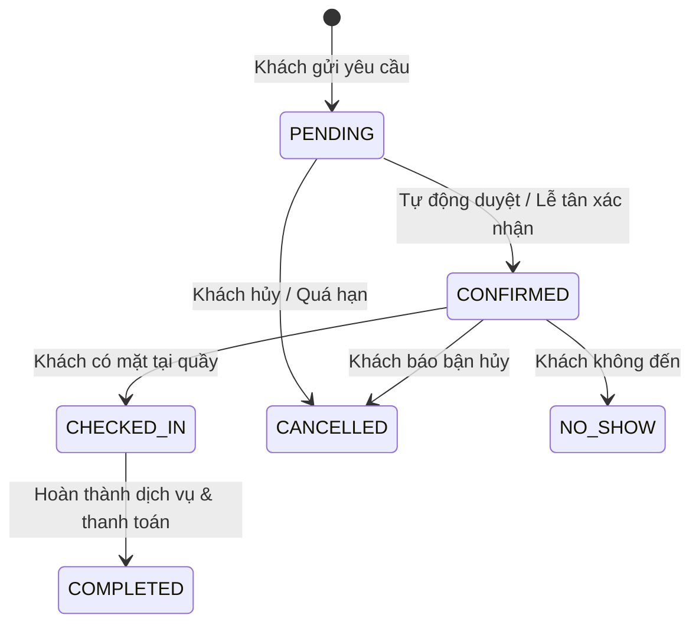

# TÀI LIỆU KIẾN TRÚC HỆ THỐNG (SYSTEM ARCHITECTURE)
**Dự án:** Booking System - Nền tảng Đặt lịch hẹn dành cho Tiệm tóc, Spa & Phòng khám nhỏ  
**Repository:** [https://github.com/vancuong2k4/booking-system](https://github.com/vancuong2k4/booking-system)  
**Phiên bản:** 1.0.0  

---

## 1. TỔNG QUAN HỆ THỐNG & TECH STACK

### 1.1 Mục tiêu hệ thống
Hệ thống giải quyết bài toán đặt lịch dịch vụ theo thời gian thực cho các mô hình dịch vụ theo khung giờ (Tiệm tóc, Salon, Spa làm đẹp, Phòng khám tư nhân nhỏ). Hệ thống cung cấp:
- **Giao diện Khách hàng (Client Portal):** Đặt lịch hẹn mượt mà không cần tài khoản, tự do chọn nhiều dịch vụ, thợ ưu thích (hoặc xếp thợ tự động) và chọn khung giờ trống chuẩn xác.
- **Giao diện Quản trị (Admin / Receptionist Dashboard):** Quản lý ca làm việc, lịch hẹn theo dạng Lưới (Calendar Grid Timeline), tạo nhanh lịch cho khách vãng lai (Walk-in), đổi trạng thái và theo dõi hiệu suất doanh thu.

### 1.2 Công nghệ sử dụng (Tech Stack)
- **Framework:** Next.js 16 (App Router) + TypeScript + React 19
- **Styling & Components:** Tailwind CSS v4 + Lucide Icons + shadcn/ui design patterns (`clsx`, `tailwind-merge`)
- **Database & ORM:** PostgreSQL / SQLite (Dev) + Prisma ORM
- **Validation & Form:** Zod + React Hook Form + `@hookform/resolvers`
- **Date/Time Engine:** `date-fns` (xử lý múi giờ, định dạng, khoảng thời gian chuẩn xác)
- **Package Manager:** `pnpm`

---

## 2. CẤU TRÚC THƯ MỤC DỰ ÁN (PROJECT DIRECTORY STRUCTURE)

```
Booking System/
├── prisma/
│   ├── schema.prisma             # Định nghĩa Prisma Schema 7 models cốt lõi
│   ├── seed.ts                   # Dữ liệu mẫu (1 shop, 5 services, 3 staff, 7 days schedules, demo bookings)
│   └── dev.db                    # SQLite database cho môi trường development
├── src/
│   ├── app/                      # Next.js App Router
│   │   ├── api/                  # Backend REST Endpoints
│   │   │   ├── availability/     # GET: Tính toán slot trống theo ngày & dịch vụ
│   │   │   │   └── route.ts
│   │   │   ├── bookings/         # POST: Đặt lịch (Client), GET: Tra cứu lịch hẹn
│   │   │   │   ├── route.ts
│   │   │   │   └── [id]/route.ts
│   │   │   └── admin/            # Admin APIs
│   │   │       ├── bookings/     # GET lịch theo ngày/nhân viên, POST walk-in
│   │   │       │   ├── route.ts
│   │   │       │   └── [id]/status/route.ts
│   │   │       ├── services/     # CRUD Dịch vụ
│   │   │       │   └── route.ts
│   │   │       ├── staff/        # CRUD Nhân viên
│   │   │       │   └── route.ts
│   │   │       ├── schedules/    # Quản lý ca làm việc & nghỉ phép
│   │   │       │   └── route.ts
│   │   │       └── stats/        # Báo cáo thống kê
│   │   │           └── route.ts
│   │   ├── (client)/             # Client Flow
│   │   │   ├── page.tsx          # Step-by-Step Booking Wizard
│   │   │   └── booking-success/  # Trang thông báo thành công & mã tra cứu
│   │   │       └── page.tsx
│   │   ├── admin/                # Admin Portal
│   │   │   ├── layout.tsx        # Navigation & Sidebar Admin
│   │   │   ├── page.tsx          # Calendar Grid View (Lịch biểu theo cột nhân viên)
│   │   │   ├── services/         # Quản lý danh mục dịch vụ
│   │   │   │   └── page.tsx
│   │   │   ├── staff/            # Quản lý nhân sự & ca trực
│   │   │   │   └── page.tsx
│   │   │   └── stats/            # Dashboard số liệu doanh thu & tỷ lệ
│   │   │       └── page.tsx
│   │   ├── layout.tsx            # Root Layout
│   │   ├── globals.css           # Global Tailwind CSS tokens
│   │   └── not-found.tsx
│   ├── components/               # Tái sử dụng UI components
│   │   ├── ui/                   # Button, Card, Dialog, Badge, Input, Select...
│   │   ├── booking/              # Client Booking Wizard Components (Step 1 -> 4)
│   │   └── admin/                # Admin Calendar Grid, WalkInModal, BookingDetailModal
│   ├── lib/                      # Core Logic & Utilities
│   │   ├── prisma.ts             # Prisma Client Singleton Instance
│   │   ├── availability.ts       # Thuật toán cốt lõi tính Slot trống (Slot Engine)
│   │   ├── validations.ts        # Zod Schemas cho Booking, Service, Staff
│   │   └── utils.ts              # cn helper, format tiền tệ VND, date helper
│   └── types/                    # TypeScript interfaces & types mở rộng
├── ARCHITECTURE.md               # Lưu trữ tài liệu kiến trúc & quy tắc nghiệp vụ
├── TASKS.md                      # Trạng thái tiến độ thực thi từng Task
├── package.json
├── pnpm-workspace.yaml
└── tsconfig.json
```

---

## 3. CƠ SỞ DỮ LIỆU & PRISMA SCHEMA SPECIFICATION

### 3.1 Mô hình Quan hệ Thực thể (ERD)



### 3.2 Vòng đời trạng thái Booking (Booking Status Lifecycle)


---

## 4. QUY TẮC NGHIỆP VỤ CỐT LÕI (CORE BUSINESS RULES)

### 4.1 Quy tắc chiếm dụng thời gian (Occupancy Rule)
- Với một đơn đặt lịch gồm tập hợp các dịch vụ $S = \{s_1, s_2, ..., s_k\}$:
  $$\text{totalDuration} = \sum_{i=1}^k s_i.\text{durationMins}$$
  $$\text{totalBuffer} = \sum_{i=1}^k s_i.\text{bufferMins}$$
  $$\text{SlotOccupied} = \text{totalDuration} + \text{totalBuffer}$$
- `endTime` lưu trong bảng `Booking` = `startTime` + `totalDuration` (Khách làm dịch vụ đến thời điểm này).
- Thời điểm nhân viên có thể nhận ca tiếp theo = `startTime` + `SlotOccupied` (đã tính thời gian dọn dẹp, nghỉ giữa ca).

### 4.2 Thuật toán tính Khung giờ trống (Availability Algorithm)
Một khung giờ ứng viên $[Start_A, End_A]$ của nhân viên $E$ vào ngày $D$ được xem là **HỢP LỆ (Available)** khi thỏa mãn tất cả 4 điều kiện sau:
1. **Giờ mở cửa:** $Start_A \ge Business.\text{openTime}$ VÀ $End_A \le Business.\text{closeTime}$.
2. **Ca làm việc:** 
   - Nhân viên có lịch làm việc vào thứ đó (`isWorkingDay = true`).
   - $Start_A \ge Schedule.\text{startTime}$ VÀ $End_A \le Schedule.\text{endTime}$.
   - **Không chạm giờ nghỉ trưa:** KHÔNG ĐƯỢC có giao cắt giữa $[Start_A, End_A]$ và $[\text{breakStart}, \text{breakEnd}]$.
3. **Nghỉ phép:** Không giao cắt với bất kỳ bản ghi `StaffTimeOff` nào của nhân viên trong ngày.
4. **Không xung đột lịch hẹn (No Overlap):**
   - Với mọi Booking hiện có của nhân viên đang ở trạng thái active (`PENDING`, `CONFIRMED`, `CHECKED_IN`) có khoảng chiếm dụng $[Start_B, End_B]$:
   - **Điều kiện không xung đột:** $\text{NOT}(Start_A < End_B \text{ AND } End_A > Start_B)$.

### 4.3 Chống đặt trùng & Race Condition (Concurrency Locking)
- Khách hàng bấm đặt lịch đồng thời: Backend thực thi logic tạo Booking bên trong một **Database Transaction** (`prisma.$transaction`).
- Bên trong transaction:
  1. Khóa và đọc lại các Booking active của Staff trong ngày đó.
  2. Tái kiểm tra điều kiện khả dụng của slot $[Start, End]$.
  3. Nếu slot vẫn còn trống: Tạo `Booking` + `BookingService` records.
  4. Nếu slot đã bị chiếm bởi request khác trước 1 mili-giây: Rollback transaction và ném lỗi HTTP 409 Conflict *"Khung giờ này vừa có khách khác đặt trước, vui lòng chọn khung giờ khác!"*.

---

## 5. DANH SÁCH API ENDPOINTS

| Phương thức | Đường dẫn | Quyền | Mô tả |
| :--- | :--- | :--- | :--- |
| `GET` | `/api/availability` | Public | Lấy danh sách khung giờ trống theo `date`, `serviceIds`, `staffId?` |
| `POST` | `/api/bookings` | Public | Đặt lịch mới (Transaction lock, auto-assign thợ rảnh nếu không chọn) |
| `GET` | `/api/bookings/:id` | Public | Tra cứu chi tiết lịch hẹn theo ID hoặc SĐT |
| `PATCH` | `/api/bookings/:id/cancel` | Public/Admin | Hủy lịch hẹn |
| `GET` | `/api/admin/bookings` | Admin | Lấy danh sách lịch theo ngày & nhân viên (cho Calendar View) |
| `PATCH` | `/api/admin/bookings/:id/status`| Admin | Chuyển trạng thái: `CONFIRMED`, `CHECKED_IN`, `COMPLETED`, `NO_SHOW` |
| `POST` | `/api/admin/bookings/walk-in` | Admin | Thêm nhanh khách vãng lai trực tiếp tại quầy |
| `GET/POST`| `/api/admin/services` | Admin | Lấy danh mục dịch vụ / Thêm dịch vụ mới |
| `PUT/DELETE`| `/api/admin/services/:id` | Admin | Cập nhật / Tắt kích hoạt dịch vụ |
| `GET/POST`| `/api/admin/staff` | Admin | Lấy danh sách / Thêm nhân viên |
| `GET/PUT` | `/api/admin/schedules` | Admin | Cập nhật ca làm việc 7 ngày của nhân viên |
| `GET` | `/api/admin/stats` | Admin | Lấy chỉ số tổng quan: Doanh thu, số lượt, tỷ lệ hủy |

---

## 6. KIẾN TRÚC CLIENT BOOKING FLOW (WIZARD 4 BƯỚC)

- **Step 1 (Chọn Dịch vụ - `StepServices.tsx`):**
  - Hỗ trợ chọn đơn hoặc đa dịch vụ cùng lúc.
  - Tự động cộng dồn tổng chi phí (VND) và tổng thời lượng làm dịch vụ + buffer time thời gian thực.
  - Hiển thị badge phân loại, thời lượng và giá tiền chuẩn xác.

- **Step 2 (Chọn Chuyên viên - `StepStaff.tsx`):**
  - Lựa chọn thợ chuyên biệt hoặc kích hoạt chế độ thông minh "Tự động sắp xếp nhân viên rảnh".
  - Hiển thị avatar chuyên viên, vai trò (Senior Stylist, Color Master, ...) và trạng thái trực.

- **Step 3 (Chọn Ngày & Giờ trống - `StepDateTime.tsx`):**
  - Thanh cuộn chọn 14 ngày kế tiếp linh hoạt, đánh dấu thứ & ngày.
  - Tự động gọi API `/api/availability` theo `date`, `serviceIds`, `staffId` đã chọn.
  - Phân nhóm khung giờ trực quan: Buổi sáng (< 12:00), Buổi chiều (12:00 - 17:00), Buổi tối (>= 17:00).
  - Tự động tính toán số lượng thợ rảnh tại mỗi slot khi chọn chế độ Auto-assign.

- **Step 4 (Thông tin & Xác nhận - `StepConfirmation.tsx`):**
  - Form thu thập Họ tên, Số điện thoại (chuẩn regex Việt Nam 10 chữ số), Ghi chú yêu cầu đặc biệt.
  - Tích hợp `react-hook-form` kết hợp bộ kiểm duyệt `zod` schema phía Client.
  - Bảng tổng kết chi tiết (Recap): Danh sách dịch vụ, thời gian, kỹ thuật viên, tổng tiền.
  - Gửi request an toàn đến `POST /api/bookings` và điều hướng mượt mà sang màn hình xác nhận.

- **Thanh tóm tắt nổi (Sticky Footer Bar - `BookingSummary.tsx`):**
  - Cố định ở đáy màn hình trên mọi kích cỡ thiết bị (Mobile & Desktop).
  - Hiển thị tóm tắt nhanh số dịch vụ, tổng thời lượng, tổng chi phí và nút chuyển bước (Next / Back).

---

## 7. KIẾN TRÚC TRANG XÁC NHẬN, TRA CỨU & HỦY LỊCH (`/booking-success`)

- **Xác nhận đặt lịch (Booking Confirmation View):**
  - Hiển thị mã đặt lịch rút gọn (8 ký tự in hoa) kèm nút sao chép mã đầy đủ vào Clipboard.
  - Thẻ thông tin trực quan: Họ tên & SĐT khách, Ngày giờ chi tiết (định dạng tiếng Việt), Chuyên viên thực hiện, Bảng kê từng dịch vụ với thời lượng & đơn giá, Tổng thanh toán.
  - Huy hiệu trạng thái động đồng bộ theo mã màu hệ thống (`CONFIRMED`, `PENDING`, `CHECKED_IN`, `COMPLETED`, `CANCELLED`, `NO_SHOW`).

- **Quy tắc bảo mật & Hủy lịch (Customer Cancellation Rules):**
  - Chỉ cho phép khách hàng hủy lịch khi trạng thái là `PENDING` hoặc `CONFIRMED`.
  - Bắt buộc nhập Số điện thoại trùng khớp với số đã đăng ký khi đặt lịch để chống việc người khác biết mã lịch và hủy trái phép.
  - Chuyển trạng thái sang `CANCELLED` ngay lập tức, giải phóng slot của nhân viên.

- **Tra cứu lịch hẹn theo Số điện thoại (Phone Booking Lookup):**
  - Khách hàng có thể tra cứu toàn bộ lịch sử hẹn chỉ bằng số điện thoại 10 số.
  - Hiển thị danh sách thẻ kết quả gồm mã lịch, ngày giờ hẹn, danh sách dịch vụ và trạng thái hiện tại.
  - Bấm vào bất kỳ lịch nào để xem chi tiết và thao tác hủy trực tiếp.
